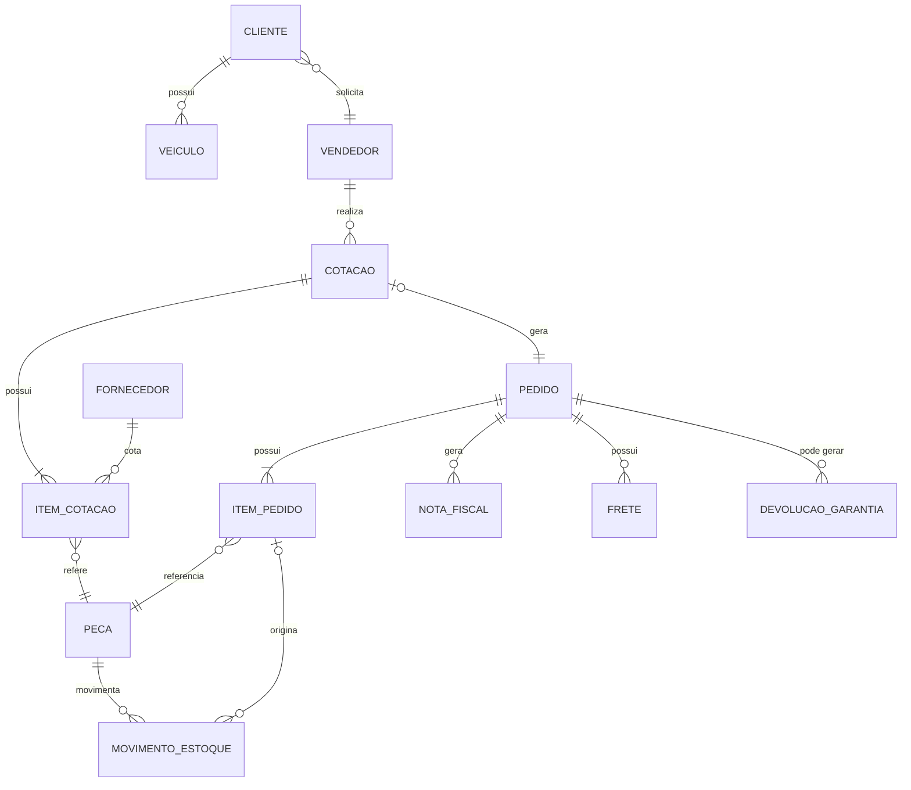

 main

  

# CK-AUTOSHOP
Modelagem de Banco de dados CK Autoshop
>>> main
# Modelagem de Banco de Dados — CK Autoshop

Trabalho acadêmico de levantamento de requisitos e modelagem conceitual de banco de dados, desenvolvido a partir de entrevista realizada na empresa CK Autoshop.

**Aplicação publicada:** [projeto-cid.vercel.app](https://projeto-cid.vercel.app/)

## Metadados

| Campo | Informação |
|---|---|
| **Organização** | CK Autoshop |
| **Disciplina** | Modelagem de Banco de Dados (MBD) |
| **Data (Entrega 1)** | 25/09/2026 |
| **Entrega** | Entrega 2 — revisão da documentação (05/11/2026) |

**Integrantes**

| Nome | RGM |
|---|---|
| Leandro Marques Coelho | 47079894 |
| Gustavo Henrique Bispo Costa | 48010677 |
| Renan Marcelino da Silva | 49876414 |
| Pedro Henrique Ferreira de Souza | 47266031 |
| Pablo Paiva Rover | 48204668 |

**Link do Repositório:**
https://github.com/Renan-Marcelino04/Projeto-Cid

---

## 1. Caracterização da Organização

### 1.1 A empresa

A **CK Autoshop** atua no segmento de peças e componentes automotivos. Sua operação envolve compra e venda de peças, atendimento a clientes empresariais, controle de estoque, expedição, transporte, faturamento e pós-venda.

A empresa trabalha principalmente no modelo **B2B (Business to Business)**, atendendo locadoras, frotistas, oficinas, seguradoras e empresas que administram frotas.

A **CK Autoshop** é uma empresa de pequeno porte classificada legalmente como ME (Microempresa).
Principais dados sobre a dimensão e estrutura da empresa. 

### 1.2 Identificação, contato e porte

| Campo | Informação |
|---|---|
| **Organização** | CK Autoshop |
| **Segmento** | Peças e componentes automotivos |
| **Modelo de atuação** | Predominantemente B2B (locadoras, frotistas, oficinas, seguradoras e organizações que administram frotas) |
| **Endereço** *(informado pelo grupo)* | Rua José Pereira Cardoso, 65 — São Miguel Paulista, São Paulo — SP, CEP 08011-310 |
| **Telefone institucional** *(informado pelo grupo)* | (11) 2033-7364 |
| **Perfil público** | [Instagram da CK Autoshop](https://www.instagram.com/ck.autoshop/) |
| **Site oficial** *(informado pelo grupo)* | [ckautoshop.com](https://ckautoshop.com/front-pages/landing-page) |
| **Porte (estimativas informadas)** | 11 funcionários · aproximadamente 90 pedidos por mês · cerca de 100 clientes |

Os números de porte são **estimativas** repassadas pelo grupo; faturamento, quantidade de vendas e de fornecedores não foram informados e não foram estimados. Endereço e telefone foram fornecidos pelo grupo e **não foram conferidos em fonte pública** nesta revisão. O telefone é um contato institucional, não pessoal.

### 1.3 Perguntas e respostas da entrevista

**Identificação da entrevista**

| Campo | Informação |
|---|---|
| **Entrevistado** | Enrique Cintra — proprietário da CK Autoshop |
| **Entrevistador** | Leandro Marques Coelho — desenvolvedor, com atividades administrativas e de TI na organização |
| **Data e horário** | 09/09/2026, 17h30 |
| **Modalidade e local** | Presencial, nas dependências da CK Autoshop (endereço acima) |
| **Participantes** | Somente Leandro realizou a entrevista |

> **Natureza das respostas.** O conteúdo abaixo é **informação relatada pelo proprietário**, organizada em linguagem acadêmica a partir do material disponibilizado pelo grupo. Não são transcrições literais nem citações diretas.

#### Bloco 1 — Cadastro, compras, estoque e vendas

**1. Como uma peça é cadastrada?**
A peça é cadastrada no sistema próprio da empresa com as informações necessárias para identificação e comercialização: código, descrição, fabricante ou marca, aplicação, fornecedor, custo e valor de venda.

**2. Como uma compra é registrada?**
A compra é feita junto aos fornecedores e normalmente atende a uma necessidade de um pedido. Segundo o relato, é registrada por meio de uma **Ordem de Compra**, que relaciona fornecedor, itens, quantidades, valores, datas e o pedido relacionado, quando aplicável. *(A Ordem de Compra consta aqui apenas como relato da entrevista; não faz parte do modelo de dados deste trabalho.)*

**3. Como a peça entra no estoque?**
As peças adquiridas são recebidas e conferidas; só depois disso a entrada é registrada no estoque. A movimentação deve permitir acompanhar quantidades, origem, destino e histórico.

**4. Como uma venda é registrada?**
O processo comercial começa com a solicitação do cliente. A equipe pesquisa as peças e elabora a cotação, com dados do cliente e do veículo, peças, quantidades, custos, margens, valores de venda e descontos, quando aplicáveis. A cotação passa por status (pendente, enviada, aprovada ou reprovada, e cancelada). Aprovada, ela dá continuidade ao processo e origina o pedido.

**5. Como a peça sai do estoque?**
A saída acompanha o pedido: antes do despacho, os itens são separados e conferidos, e a saída é registrada como movimentação de estoque relacionada à operação que a originou, para que seja possível rastreá-la.

**6. Quem participa de cada etapa?**
O material indica uma equipe que pesquisa as peças e elabora cotações e uma equipe de expedição (separação, conferência, embalagem e despacho); o proprietário é o responsável pela empresa.

**7. Quais informações são registradas no sistema?**
O sistema próprio acompanha cotações, compras, fornecedores, clientes, estoque, pedidos, notas fiscais, financeiro, devoluções, garantias e o acompanhamento operacional. Entre os dados: peças (código, descrição, marca, aplicação, custo, valor de venda), clientes e veículos (placa, marca, modelo, ano, quilometragem), cotações e pedidos (valores, descontos, status), movimentações de estoque, notas fiscais, fretes e ocorrências de devolução/garantia.

#### Bloco 2 — Fluxo de compra e venda

**8. Quem compra?**
As compras são feitas pela empresa junto aos fornecedores, a partir da necessidade dos pedidos (ver resposta 2).

**9. De quem compra?**
De fornecedores de peças automotivas.

**10. O que é comprado?**
Peças e componentes automotivos, normalmente para atender a necessidade de um pedido.

**11. Como entra no estoque?**
Ver resposta 3: recebimento e conferência antecedem o registro da entrada.

**12. Quem vende?**
A venda parte da equipe comercial, que monta as cotações.

**13. Para quem vende?**
Principalmente para empresas (B2B): locadoras, frotistas, oficinas, seguradoras e outras organizações que administram frotas. A empresa tem cerca de 100 clientes (estimativa).

**14. O que acontece com o estoque depois da venda?**
As quantidades são atualizadas por movimentações de saída ligadas ao pedido (ver resposta 5). Devoluções e garantias seguem processos específicos, tratados como ocorrências e não como vendas comuns.

#### Bloco 3 — Funcionamento da empresa

**15. Quem trabalha lá?**
A empresa tem 11 funcionários (informado).

**16. Quais atividades são realizadas?**
Cotação e venda; compras junto a fornecedores; recebimento e conferência; controle de estoque; separação, embalagem, despacho e transporte; faturamento e notas fiscais; acompanhamento financeiro; pós-venda (devoluções e garantias).

**17. Como são cadastrados clientes/membros?**
Como a CK Autoshop atende empresas, o cadastro é de **clientes**, vinculados às operações comerciais (cotações e pedidos). Os veículos são registrados com placa, marca, modelo, ano e, quando necessário, quilometragem.

**18. Como controlam produtos/estoque?**
Pelo sistema próprio, por entradas e saídas de peças relacionadas a compras, pedidos e vendas, acompanhando disponibilidade, quantidades, custos, fornecedores e movimentações (ver respostas 3 e 5).

**19. Como registram vendas ou atendimentos?**
No sistema, pelo fluxo cotação → aprovação → pedido (ver resposta 4).

**20. Como controlam pagamentos?**
O financeiro acompanha faturamento, notas fiscais, valor, desconto, valor líquido, vencimento, status e data de pagamento.

**21. Como organizam pedidos?**
Os pedidos (cerca de 90 por mês, estimativa) têm status que indicam sua situação no processo operacional, incluindo o andamento da expedição.

**22. Usam papel, Excel ou sistema?**
Utilizam um sistema próprio de gestão. O material menciona também o uso possível de planilhas, PDFs, WhatsApp e outros controles externos, sem indicar que todas as atividades dependam deles.

**23. Quais problemas enfrentam atualmente?**
O principal desafio é a integração e a rastreabilidade das informações. Também foram relatados: dificuldade de acompanhar o status dos pedidos; atrasos de fornecedores e pedidos aguardando peças; falta de visibilidade sobre prazos; controle da margem real das vendas; informações espalhadas entre sistema, planilhas, PDFs e WhatsApp; controle de devoluções e garantias; comunicação entre setores; rastreabilidade de documentos; e falta de indicadores. Esses pontos estão numerados (P1 a P11) na seção 3.

### 1.4 Relato consolidado da entrevista

A CK Autoshop é uma empresa de peças e componentes automotivos que atende principalmente outras empresas, como locadoras, frotistas, oficinas e seguradoras. O ciclo operacional começa quando um cliente solicita peças: a equipe pesquisa as opções, monta a cotação com custo, margem, valor de venda e eventuais descontos, e a envia ao cliente. Aprovada a cotação, ela dá origem a um pedido.

Para atender o pedido, a empresa compra as peças de fornecedores; segundo o proprietário, a compra é registrada em Ordens de Compra. As peças recebidas são conferidas e só então entram no estoque, com movimentação registrada. Com as peças disponíveis, a expedição separa, confere, embala (com plástico-bolha, fitas, papelão ou isopor, conforme a peça) e despacha o pedido, que segue para transporte e entrega.

Em paralelo, o pedido é faturado por nota fiscal e acompanhado pelo financeiro quanto a valores, vencimentos e pagamentos. Após a entrega, a empresa acompanha problemas de recebimento e trata devoluções e garantias por processos específicos. Todo esse acompanhamento é feito em um sistema próprio, complementado possivelmente por planilhas, PDFs e WhatsApp. O principal problema relatado é justamente a dificuldade de integrar e rastrear as informações entre essas etapas.

### 1.5 Observações presenciais e limitações

- **Informado pelo proprietário:** todos os processos, números e dificuldades descritos nas seções 1.3 e 1.4.
- **Relato e observação:** somente Leandro esteve presente na entrevista. As informações sobre processos, números e dificuldades foram relatadas pelo proprietário.
- **Limitações:** os números de porte são estimativas; endereço e telefone foram informados pelo grupo; o relato é de uma única pessoa (o proprietário).

### 1.6 Evidências

| Evidência | Situação |
|---|---|
| Perfil público | [Instagram da CK Autoshop](https://www.instagram.com/ck.autoshop/) (informado pelo grupo) |
| Logotipo da empresa |  Marca da CK Auto Shop ("Variedade e Compromisso"), arquivo `logo-ck-autoshop.png` |
| Site oficial | [ckautoshop.com](https://ckautoshop.com/front-pages/landing-page) (informado pelo grupo) |

### 1.7 Resumo do levantamento

A entrevista (09/09/2026, presencial, conduzida por Leandro Marques Coelho com o proprietário Enrique Cintra) cobriu cadastro de peças, compras, estoque, cotações e vendas, expedição, financeiro, pós-venda, sistemas e problemas. O resultado é um ciclo cotação → pedido → compra → recebimento → estoque → expedição → faturamento → pós-venda, com o desafio central de integração e rastreabilidade. O relato completo está nas seções 1.3 a 1.5 deste documento.

---

## 2. Processos de Negócio

### 2.1 Cadastro de peças
As peças são cadastradas com as informações necessárias para identificação e comercialização: código, descrição, marca/fabricante, aplicação, fornecedor, custo e valor de venda.

### 2.2 Cadastro de clientes e veículos
Os clientes são cadastrados e vinculados às operações comerciais. Também são registradas informações dos veículos: **placa, marca, modelo, ano** e **quilometragem**, quando necessária.

### 2.3 Cotação e venda
O processo comercial começa com a solicitação do cliente. A equipe pesquisa as peças, monta a cotação e define custo, margem e valor de venda. A cotação pode conter cliente, veículo, peças, quantidades, valores, descontos e demais custos.

**Status identificados:** `Pendente → Enviada → Aprovada/Reprovada → Cancelada`

Aprovada a cotação, o processo segue para o pedido.

**Fluxo:** `Cliente → Cotação → Aprovação → Pedido`

### 2.4 Compra
A compra é feita junto aos fornecedores e normalmente atende a uma necessidade de um pedido. É registrada por meio de uma **Ordem de Compra**, com fornecedor, itens, quantidades, valores, datas e pedido relacionado.

**Fluxo:** `Necessidade → Ordem de Compra → Fornecedor → Recebimento → Conferência → Estoque`

> **Nota:** a Ordem de Compra é descrita pelo proprietário na entrevista e por isso permanece neste relato do processo, mas foi **retirada do modelo de dados** (DER, dicionário de dados e SQL).

### 2.5 Controle de estoque
O estoque é controlado pelas entradas e saídas das peças, relacionadas a compras, pedidos e vendas. O controle permite acompanhar disponibilidade, quantidades, custos, fornecedores e movimentações. Existem processos específicos para **devoluções e garantias**.

**Fluxo:** `Entrada → Estoque → Separação → Saída`

### 2.6 Expedição, embalagem e despacho
Confirmada a disponibilidade das peças, a equipe de expedição faz separação, conferência, embalagem e despacho. São usados materiais de proteção como **plástico-bolha, fitas, papelão, isopor** e outros adequados ao tipo de peça. Depois da embalagem, o pedido segue para transporte.

**Fluxo:** `Pedido → Separação → Conferência → Embalagem → Despacho → Transporte → Entrega`

### 2.7 Processo financeiro
Envolve faturamento, notas fiscais e contas a receber. São acompanhados valor, desconto, valor líquido, vencimento, status e data de pagamento.

**Fluxo:** `Faturamento → Nota Fiscal → Conta a Receber → Vencimento → Pagamento`

### 2.8 Pós-venda
Após a entrega, a empresa acompanha a operação e trata situações como problemas no recebimento, devoluções e garantias.

**Fluxo:** `Entrega → Acompanhamento → Ocorrência/Devolução/Garantia (quando aplicável)`

### 2.9 Processos, requisitos e regras típicos do ramo automotivo analisados e não incluídos

| Item analisado | Situação | Justificativa |
|---|---|---|
| Ordem de Compra e seus itens (como entidades do modelo) | **Excluído — confirmado** | Decisão do grupo em 31/10/2026; permanece só como relato da entrevista. Os dados de compra e recebimento ficam no Item do Pedido |

---

## 3. Problemas e Necessidades Identificados

O principal desafio apontado na entrevista é a **integração e a rastreabilidade das informações** ao longo da operação, que passa por cotação, compra, estoque, expedição, transporte, faturamento, financeiro e pós-venda.

Problemas levantados (códigos estáveis para rastreabilidade):

- **P1** — Dificuldade de acompanhar o status dos pedidos;
- **P2** — Atrasos de fornecedores e pedidos aguardando peças;
- **P3** — Falta de visibilidade sobre prazos;
- **P4** — Necessidade de controlar a margem real das vendas;
- **P5** — Dificuldade de rastrear toda a operação;
- **P6** — Informações espalhadas entre sistema, planilhas, PDFs e WhatsApp;
- **P7** — Controle de devoluções e garantias;
- **P8** — Necessidade de integração e comunicação entre os setores;
- **P9** — Rastreabilidade de documentos;
- **P10** — Necessidade de indicadores para acompanhamento da operação;
- **P11** — Acompanhamento financeiro (vencimentos, pagamentos e situação).

### 3.1 Problema central

A CK Autoshop precisa de uma estrutura de informações que integre e permita rastrear as etapas da operação, facilitando o acompanhamento de pedidos, peças, compras, estoque, vendas, expedições, entregas e processos relacionados.

### 3.2 Matriz de rastreabilidade dos problemas

Cada problema é associado a requisitos (RF, RNF) e às entidades do DER que o sustentam.

| Código | Problema identificado | Requisito relacionado | Entidades/tabelas envolvidas |
|---|---|---|---|
| P1 | Acompanhar o status dos pedidos | RF07, RF16, RN10 | `pedido` (status, status_expedicao, data_autorizacao), `cotacao` |
| P2 | Atrasos de fornecedores e pedidos aguardando peças | RF09 | `item_pedido` (data_prevista_entrega, data_recebimento, situacao_compra_recebimento), `fornecedor`, `pedido` |
| P3 | Visibilidade sobre prazos | RF11, RF13 | `frete` (prazo_entrega, data_entrega), `pedido` |
| P4 | Margem real das vendas | RF05, RF07 | `item_pedido` (valor_custo, valor_venda, valor_extra), `cotacao` (desconto, frete, imposto) |
| P5 | Rastrear a operação de ponta a ponta | RF16, RN16, RNF04 | `cotacao`, `pedido`, `item_pedido`, `nota_fiscal`, `frete`, `movimento_estoque` |
| P6 | Informações dispersas entre sistema, planilhas, PDFs e WhatsApp | RNF03, RF16 | Nenhuma tabela representa isso diretamente |
| P7 | Devoluções e garantias | RF15, RN13 | `devolucao_garantia`, `pedido` |
| P8 | Integração entre setores | RNF02, RNF03 | Relacionamentos do modelo como um todo |
| P9 | Rastreabilidade de documentos | RF12, RN14 | `nota_fiscal`, `pedido` |
| P10 | Indicadores de acompanhamento | RF16 | Conforme KPI (seção 11) |
| P11 | Acompanhamento financeiro | RF14, RN15 | `nota_fiscal` (valor_nota, data_emissao) |

---

## 4. Requisitos do Sistema

Os requisitos vieram da entrevista, dos processos observados e das informações identificadas no sistema usado pela empresa.

### 4.1 Requisitos Funcionais

> O código **RF08** não é utilizado nesta versão; os demais códigos foram mantidos, sem renumeração.

| ID | Requisito | Descrição |
|---|---|---|
| **RF01** | Cadastro de peças | Cadastrar e consultar peças, com as informações necessárias para identificação, aplicação e comercialização. |
| **RF02** | Cadastro de clientes | Cadastrar e consultar clientes para uso em cotações, pedidos e vendas. |
| **RF03** | Cadastro de veículos | Registrar veículos relacionados aos clientes, com placa, marca, modelo e ano. |
| **RF04** | Cadastro de fornecedores | Cadastrar e consultar fornecedores de peças automotivas. |
| **RF05** | Registro de cotações | Criar cotações relacionando cliente, veículo, peças, quantidades e valores. |
| **RF06** | Status das cotações | Acompanhar o andamento das cotações: pendente, enviada, aprovada, reprovada e cancelada. |
| **RF07** | Registro de pedidos | Gerar e acompanhar pedidos originados das operações comerciais. |
| **RF09** | Recebimento e conferência | Registrar o recebimento e a conferência das peças adquiridas. |
| **RF10** | Entrada e saída de estoque | Registrar as movimentações de estoque e manter o controle das quantidades disponíveis. |
| **RF11** | Controle de expedição | Acompanhar separação, conferência, embalagem e despacho dos pedidos. |
| **RF12** | Faturamento e notas fiscais | Registrar e relacionar faturamento e notas fiscais aos pedidos e respectivas operações. |
| **RF13** | Transporte e entrega | Registrar e acompanhar informações de transporte e entrega dos pedidos. |
| **RF14** | Controle financeiro | Acompanhar valores, vencimentos, pagamentos e situações financeiras das operações. |
| **RF15** | Devoluções e garantias | Registrar e acompanhar processos de devolução e garantia de peças. |
| **RF16** | Consulta e rastreabilidade | Consultar histórico e situação das operações, facilitando a rastreabilidade de pedidos, peças e documentos. |

### 4.2 Requisitos Não Funcionais

| ID | Requisito | Descrição |
|---|---|---|
| **RNF01** | Segurança | Controlar o acesso às informações conforme os usuários e suas responsabilidades. |
| **RNF02** | Integridade dos dados | Manter de forma consistente os relacionamentos entre clientes, veículos, peças, pedidos, compras, estoque e demais operações. |
| **RNF03** | Usabilidade | Apresentar as informações de forma organizada e compreensível para os diferentes setores. |
| **RNF04** | Rastreabilidade | Permitir o acompanhamento do histórico das operações e de suas alterações. |
| **RNF05** | Disponibilidade | Estar disponível durante a operação da empresa. |

### 4.3 Campos envolvidos em cada requisito

Detalhamento a partir dos atributos do DER atual (sem alterar o significado dos requisitos).

| ID | Campos envolvidos |
|---|---|
| RF01 | `peca`: codigo, sku, descricao, aplicacao, marca, ncm, unidade_medida, localizacao_estoque, quantidade_estoque, valor_custo, valor_venda, categoria, status |
| RF02 | `cliente`: nome, documento, contato, endereco, status |
| RF03 | `veiculo`: placa, marca, modelo, ano_fabricacao, ano_modelo, chassi, quilometragem; cliente proprietário |
| RF04 | `fornecedor`: nome, documento, contato, endereco, segmento, subsegmento, status |
| RF05 | `cotacao`: data_cotacao, desconto, frete, imposto, observacao, status; `item_cotacao`: quantidade, custo, valor_venda (peça e fornecedor cotados, por relacionamento); cliente, veículo e vendedor da cotação |
| RF06 | `cotacao.status` |
| RF07 | `pedido`: data_autorizacao, status, status_expedicao, endereco_entrega, valor_frete, observacao; `item_pedido`: quantidade, valor_custo, valor_venda, valor_extra, status; cliente, veículo, vendedor e cotação de origem |
| RF09 | `item_pedido`: data_prevista_entrega, data_recebimento, situacao_compra_recebimento (recebimento e conferência das peças compradas) |
| RF10 | `movimento_estoque`: tipo_movimentacao, quantidade, data_cadastro, motivo, observacao; origem no item do pedido (relacionamento ORIGINA) |
| RF11 | `pedido.status_expedicao` |
| RF12 | `nota_fiscal`: numero, serie, data_emissao, data_operacao, valor_nota, valor_frete, tipo, situacao, chave_acesso; pedido relacionado |
| RF13 | `frete`: placa, transportadora, endereco_entrega, prazo_entrega, data_entrega, municipio_entrega, contato_nome, contato_telefone, status |
| RF14 | `nota_fiscal`: valor_nota, valor_frete, data_emissao, situacao |
| RF15 | `devolucao_garantia`: tipo, status, motivo, descricao, observacoes, data; pedido relacionado |
| RF16 | Consulta sobre `cotacao`, `pedido`, `item_pedido`, `nota_fiscal`, `frete`, `movimento_estoque` |

---

## 5. Regras de Negócio

> O código **RN05** não é utilizado nesta versão; os demais códigos foram mantidos, sem renumeração.

Condições e restrições observadas no funcionamento da CK Autoshop que devem ser consideradas na organização dos dados.

| ID | Regra | Descrição |
|---|---|---|
| **RN01** | Identificação do cliente | Uma cotação ou pedido deve estar associado a um cliente. |
| **RN02** | Veículo | Quando a operação envolver um veículo, suas informações devem ser registradas e vinculadas ao cliente correspondente. |
| **RN03** | Itens da cotação | Uma cotação pode ter um ou mais itens, cada um relacionado a uma peça e contendo quantidade e valores. |
| **RN04** | Aprovação da cotação | Uma cotação aprovada pode dar continuidade ao processo e originar um pedido. |
| **RN06** | Recebimento | As peças adquiridas devem ser recebidas e conferidas antes do registro de entrada no sistema. |
| **RN07** | Entrada no estoque | Após a conferência, a entrada da mercadoria deve ser registrada para atualizar o estoque. |
| **RN08** | Movimentação de estoque | As quantidades disponíveis devem ser atualizadas conforme as entradas e saídas registradas. |
| **RN09** | Saída de estoque | A saída de uma peça deve estar relacionada à operação que originou sua destinação, permitindo rastrear a movimentação. |
| **RN10** | Status dos pedidos | Os pedidos devem ter status representando sua situação dentro do processo operacional. |
| **RN11** | Expedição | Antes do despacho, os itens destinados ao cliente devem ser separados e conferidos. |
| **RN12** | Embalagem | As peças devem ser embaladas conforme suas características, com materiais de proteção adequados (plástico-bolha, papelão, isopor e fitas). |
| **RN13** | Devoluções e garantias | Devem ser registradas e tratadas como ocorrências específicas, não como vendas ou movimentações normais. |
| **RN14** | Faturamento | As informações de Nota Fiscal devem estar relacionadas à operação correspondente. |
| **RN15** | Financeiro | Os valores a receber devem ter informações que permitam acompanhar vencimento, pagamento e situação financeira. |
| **RN16** | Rastreabilidade | As operações devem manter informações suficientes para identificar origem, responsáveis e etapas realizadas. |

---

## 6. Modelagem Conceitual

As entidades foram identificadas a partir dos processos levantados na entrevista e das estruturas observadas no sistema da CK Autoshop. O modelo conceitual usa apenas as entidades do recorte principal da operação, sem reproduzir toda a complexidade do banco de dados existente.

### 6.1 Entidades e atributos

Entidades e atributos conforme o DER da seção 8 (13 entidades). Os atributos identificadores aparecem em negrito.

| Entidade | Descrição | Atributos (conforme o DER) |
|---|---|---|
| **Cliente** | Empresas atendidas pela CK Autoshop | **id_cliente**; nome; documento; contato; endereço; status |
| **Veículo** | Veículo relacionado ao atendimento do cliente | **id_veiculo**; placa; marca; modelo; ano de fabricação; ano do modelo; chassi; quilometragem |
| **Vendedor** | Pessoa da equipe comercial que elabora cotações | **id_vendedor**; nome; telefone; e-mail; cargo; comissão; data de admissão; status |
| **Cotação** | Proposta comercial elaborada para o cliente | **id_cotacao**; data da cotação; desconto; frete; imposto; observação; status |
| **Item da Cotação** | Cada peça cotada, com quantidade, custo e valor de venda | **id_item_cotacao**; quantidade; custo; valor de venda |
| **Fornecedor** | Empresas que fornecem peças para a CK Autoshop | **id_fornecedor**; nome; documento; contato; endereço; segmento; subsegmento; status |
| **Peça** | Produtos e peças automotivas comercializados | **id_peca**; código; SKU; descrição; aplicação; marca; NCM; unidade de medida; localização no estoque; quantidade em estoque; valor de custo; valor de venda; categoria; status |
| **Pedido** | Operação comercial gerada após a aprovação da cotação | **id_pedido**; data de autorização; status; status da expedição; endereço de entrega; valor do frete; observação |
| **Item do Pedido** | Cada peça de um pedido, incluindo dados de compra e recebimento | **id_item_pedido**; quantidade; valor de custo; valor de venda; valor extra; status; data prevista de entrega; data de recebimento; situação da compra/recebimento |
| **Movimento de Estoque** | Entradas e saídas das peças no estoque | **id_movimento**; tipo de movimentação; quantidade; data de cadastro; motivo; observação |
| **Nota Fiscal** | Documento fiscal da operação | **id_nota_fiscal**; número; série; data de emissão; data da operação; valor da nota; valor do frete; tipo; situação; chave de acesso |
| **Frete** | Transporte e entrega da mercadoria | **id_frete**; placa; transportadora; endereço de entrega; prazo de entrega; data de entrega; município de entrega; nome do contato; telefone do contato; status |
| **Devolução/Garantia** | Ocorrências de devolução ou garantia de peças | **id_devolucao**; tipo; status; motivo; descrição; observações; data |

> **Nomenclatura:** no banco da empresa essa estrutura aparece como **Mercadoria**; no modelo usamos **Peça**, termo empregado pela empresa na descrição dos processos. A Ordem de Compra não é uma entidade do modelo: os dados de compra e recebimento ficam no **Item do Pedido** (data prevista de entrega, data de recebimento e situação) e a entrada em estoque, no **Movimento de Estoque**.

### 6.2 Relacionamentos e cardinalidades

Os relacionamentos abaixo seguem o DER da seção 8, **como desenhado**, com a cardinalidade de cada lado na ordem em que aparece na imagem.

| Nº | Entidade A | Card. | Relacionamento | Card. | Entidade B | Regra ou processo |
|---|---|---|---|---|---|---|
| 1 | Cliente | (1,1) | POSSUI | (0,n) | Veículo | RN02 |
| 2 | Cliente | (0,n) | SOLICITA | (1,1) | Vendedor | Atendimento comercial |
| 3 | Vendedor | (0,n) | REALIZA | (1,1) | Cotação | RN16 |
| 4 | Cotação | (1,1) | POSSUI | (1,n) | Item da Cotação | RN03 |
| 5 | Fornecedor | (0,n) | COTA | (1,1) | Item da Cotação | Seção 2.3 |
| 6 | Item da Cotação | (1,1) | REFERE | (0,n) | Peça | RN03 |
| 7 | Cotação | (0,1) | GERA | (1,1) | Pedido | RN04 |
| 8 | Pedido | (1,1) | POSSUI | (1,n) | Item do Pedido | Seção 2.3 |
| 9 | Item do Pedido | (1,1) | REFERENCIA | (0,n) | Peça | Seção 2.3 |
| 10 | Peça | (0,n) | MOVIMENTA | (1,1) | Movimento de Estoque | RN08 |
| 11 | Item do Pedido | (0,n) | ORIGINA | (0,1) | Movimento de Estoque | RN09, RN16 |
| 12 | Pedido | (0,n) | GERA | (1,1) | Nota Fiscal | RN14, RF12 |
| 13 | Pedido | (0,n) | POSSUI | (1,1) | Frete | Seção 2.6, RF13 |
| 14 | Pedido | (0,n) | PODE_GERAR | (1,1) | Devolução/Garantia | RN13, seção 2.8 |

---

## 7. Dicionário de Dados

O dicionário de dados da CK Autoshop está em arquivo HTML separado: [`dicionario-dados.html`](dicionario-dados.html) (versão 1.2, 13 entidades). O banco de dados não é reproduzido neste README.

---

## 8. Diagrama Entidade-Relacionamento (DER)

O DER foi desenhado no **brModelo** e representa o modelo conceitual da CK Autoshop com **13 entidades** e **14 relacionamentos** (retângulo = entidade, losango = relacionamento, círculo = atributo, círculo preenchido = chave primária, cardinalidade mínima/máxima ao lado do relacionamento).

Em relação à Entrega 1, o DER passou a incluir **Item da Cotação**, os dados de compra e recebimento no **Item do Pedido** (no lugar da Ordem de Compra, que não é entidade do modelo), o relacionamento **ORIGINA** entre Item do Pedido e Movimento de Estoque, e deixou de exibir atributos de chave estrangeira.

### 8.1 Visão geral dos relacionamentos

A tabela completa, com a regra associada a cada relacionamento, está na seção 6.2. Leitura resumida do fluxo principal (notação Crow's Foot, sem atributos, **conforme desenhado no DER**):

### 8.2 Legenda da notação

| Símbolo | Leitura |
|---|---|
| `(1,1)` | exatamente um (obrigatório) |
| `(0,n)` | zero ou vários (opcional) |
| **●** (círculo preenchido) | atributo identificador (chave primária) |
| **○** (círculo vazio) | atributo comum |

## 9. Justificativa Técnica

A modelagem conceitual da CK Autoshop foi desenvolvida com base na entrevista realizada, nos
processos identificados e nas informações observadas no sistema da empresa. O modelo representa os
principais processos de clientes, veículos, peças, cotações, pedidos, compras, estoque, faturamento,
transporte, financeiro e pós-venda.

As entidades e relacionamentos foram definidos de acordo com esses processos e suas regras de
negócio. A separação entre operações e seus respectivos itens, como **Cotação e Item da Cotação** e
**Pedido e Item do Pedido**, permite representar diferentes peças e quantidades em uma mesma
operação.

O **Movimento de Estoque** foi utilizado para registrar entradas e saídas das peças, permitindo
maior rastreabilidade das movimentações. As entidades relacionadas a **Nota Fiscal**, **Frete** e
**Financeiro** representam as etapas posteriores à venda.

O modelo não busca reproduzir todo o banco de dados existente na empresa, mas representar de forma
conceitual os principais processos analisados, mantendo uma estrutura organizada e adequada para a
futura transformação em modelo lógico e implementação SQL (arquivos separados — seção 7).

### 9.1 Conversão do modelo conceitual

Regras aplicadas (notação do brModelo: entidade = retângulo, relacionamento = losango, cardinalidade mínima/máxima):

| Elemento conceitual | Regra de conversão | Exemplo neste modelo |
|---|---|---|
| Entidade | Vira uma tabela | `cliente`, `peca`, `pedido` |
| Atributo identificador (círculo preenchido) | Vira chave primária (PK) | `id_cliente`, `id_pedido` |
| Atributo comum | Vira coluna; `(1,…)` na mínima vira `NOT NULL` | `cliente.nome` |
| Relacionamento 1:N | A PK do lado 1 vira FK na tabela do lado N | `cliente_id` em `veiculo` |
| Relacionamento N:N | Tabela associativa com as PKs das duas entidades | `item_pedido` (pedido × peça) |
| Cardinalidade mínima 0 no lado da FK | FK opcional (aceita nulo) | `item_pedido`, fornecedor do item |

Neste DER todos os relacionamentos têm máximo 1 em pelo menos um dos lados, então convertem-se em chave estrangeira no lado N, sem tabela associativa adicional. Os itens (Item da Cotação e Item do Pedido) já são entidades próprias.

### 9.2 Normalização

- **1FN:** os atributos do modelo são atômicos, sem listas ou grupos repetidos.
- **2FN:** todas as tabelas têm chave primária simples (identificador único); não há dependência parcial de chave composta.
- **3FN:** os dados de cliente, veículo e vendedor são alcançados pelas relações com a cotação e o pedido; `item_pedido.valor_custo` repete `peca.valor_custo` de forma intencional, para preservar o preço histórico das vendas.

### 9.3 Justificativas das decisões

| Decisão | Justificativa |
|---|---|
| PK numérica automática em cada tabela | Identificador único e estável, independente de dados de negócio |
| FKs com `ON DELETE RESTRICT` | Preservar histórico de operações (RN16, RNF04) |
| `item_pedido` e `item_cotacao` separados de `pedido`/`cotacao` | Uma operação tem várias peças (RN03) |
| `movimento_estoque` como histórico | Rastrear entradas e saídas (RN08, RN09) |
| Exclusão da Ordem de Compra | Decisão do grupo (31/10/2026) |

---

## 10. Uso de Inteligência Artificial

Durante o desenvolvimento deste projeto foram utilizadas ferramentas de Inteligência Artificial
como apoio às atividades de análise, organização, modelagem e documentação das informações
levantadas sobre a CK Autoshop.

Foram utilizadas principalmente duas ferramentas: **ChatGPT**, para apoio na análise e estruturação
do conteúdo do projeto, e **Claude**, utilizado principalmente como apoio na formatação e
organização do arquivo.

A utilização das ferramentas de IA não substituiu o levantamento realizado junto à organização.
As informações sobre os processos, atividades e funcionamento da empresa foram obtidas por meio de
entrevista, observação dos processos e análise das informações disponibilizadas pela organização.

### 10.1 Ferramentas utilizadas

**ChatGPT** — usado como apoio nas etapas de análise e modelagem, principalmente em:

- organização das informações obtidas durante a entrevista;
- identificação e descrição dos processos de negócio;
- elaboração e revisão dos fluxogramas;
- identificação dos requisitos funcionais e não funcionais;
- identificação e organização das regras de negócio;
- levantamento preliminar de entidades e atributos;
- estruturação do dicionário de dados;
- análise dos relacionamentos e cardinalidades;
- revisão da coerência da modelagem;
- organização e revisão dos textos da documentação.

**Claude** — usado principalmente como apoio à formatação e organização do arquivo, na apresentação
visual e estrutural do conteúdo produzido durante o projeto:

- organização da estrutura do documento;
- padronização da formatação;
- organização de títulos e subtítulos;
- melhoria da apresentação visual;
- ajustes de estrutura e layout do arquivo;
- revisão da organização do conteúdo para a entrega.

### 10.2 Exemplos de prompts utilizados

| # | Finalidade | Prompt |
|---|---|---|
| 1 | Identificação dos processos de negócio | "Com base nas informações levantadas durante a entrevista com a empresa, identifique os principais processos de negócio envolvidos na compra, venda, estoque, expedição, transporte, faturamento e pós-venda de peças automotivas." |
| 2 | Organização do processo de cotação e venda | "Com base nas informações fornecidas sobre o processo de cotação e venda da empresa, organize as etapas do processo de forma sequencial e identifique os principais pontos de decisão." |
| 3 | Elaboração do fluxograma | "Com base neste processo, monte um fluxograma contendo início, atividades, decisões e fim, utilizando uma estrutura adequada para um trabalho acadêmico de modelagem de banco de dados." |
| 4 | Levantamento de requisitos | "A partir dos processos e problemas identificados na empresa, levante os requisitos funcionais e não funcionais que o sistema deve atender. Considere apenas informações compatíveis com os processos apresentados." |
| 5 | Identificação das regras de negócio | "Com base nas informações da entrevista, identifique as principais regras de negócio relacionadas aos processos de compra, venda, estoque, expedição, faturamento e pós-venda. Não invente regras que não tenham sido informadas." |
| 6 | Identificação de entidades e atributos | "Com base nos processos levantados e nas informações fornecidas sobre o funcionamento da empresa e do sistema, identifique as principais entidades e seus possíveis atributos para um modelo conceitual de banco de dados." |
| 7 | Análise dos relacionamentos | "Analise estas entidades e identifique quais relacionamentos existem entre elas. Sugira também as cardinalidades, considerando as regras de negócio apresentadas." |
| 8 | Revisão do modelo | "Analise esta modelagem conceitual e identifique possíveis erros, principalmente relacionamentos inadequados, entidades desnecessárias e cardinalidades incorretas. Aponte o que deve ser corrigido e explique o motivo." |
| 9 | Levantamento de dados | [`levantamento.md`](levantamento.md) |
| Dicionário de dados | "Organize as entidades e atributos identificados em um dicionário de dados conceitual preliminar, contendo o atributo, sua descrição e a regra de negócio relacionada." |
| 10 | Formatação do documento | "Organize e formate este conteúdo para apresentação acadêmica, mantendo as informações originais, estruturando títulos, subtítulos, tabelas e seções de forma clara e padronizada." |

O prompt 10 foi utilizado principalmente com o Claude, devido à sua utilização no processo de
organização e formatação do arquivo.

### 10.3 Processo de utilização

A utilização das ferramentas ocorreu de maneira iterativa. Primeiro foram levantadas as informações
sobre a organização e seus processos. Depois, essas informações foram fornecidas às ferramentas de
IA para auxiliar na organização, análise e estruturação do conteúdo.

As respostas geradas foram analisadas pelos integrantes do projeto. Quando foram identificadas
informações incorretas, incompletas ou que não correspondiam ao funcionamento real da organização,
elas foram corrigidas, ajustadas ou descartadas.

Na modelagem do banco de dados, as sugestões da IA foram usadas como apoio e passaram por revisão
dos integrantes, principalmente na definição das entidades, atributos, relacionamentos e regras de
negócio.

### 10.4 Responsabilidade pelas informações

A Inteligência Artificial foi utilizada como ferramenta de apoio, não como fonte primária das
informações sobre a organização.

Os dados referentes ao funcionamento da CK Autoshop foram obtidos por meio do levantamento
realizado junto à empresa. As decisões finais sobre processos de negócio, requisitos, regras de
negócio e elementos da modelagem foram tomadas pelos integrantes do projeto.

O uso do ChatGPT e do Claude teve como objetivo auxiliar na análise, estruturação, revisão e
apresentação das informações, mantendo a validação humana sobre o conteúdo final do trabalho.

### 10.5 Uso de IA na revisão da Entrega 2 (nov/2026)

| Item | Registro |
|---|---|
| **Ferramenta** | Claude (Anthropic) |
| **Etapa** | Revisão e correção da documentação (README, dicionário de dados e imagem do DER) para a Entrega 2 |
| **Objetivo** | Remover a Ordem de Compra do modelo; atualizar o README e o dicionário para o DER corrigido; documentar a entrevista; organizar problemas, requisitos, BI e KPIs |
| **Exemplos de instruções desta etapa** | "Revise e corrija o README conforme as exigências do professor; não invente informações." / "Exclua totalmente a Ordem de Compra do dicionário, do DER e do README; mantenha o que vier da entrevista." / "Apresente perguntas e respostas da entrevista no README." *(instruções desta revisão, não registros de interações anteriores)* |
| **Resumo das respostas** | README, dicionário e DER atualizados |
| **Fontes e verificações** | Somente arquivos fornecidos pelo grupo; nenhuma fonte externa consultada; contagens de entidades/tabelas conferidas no texto |
| **Aceito / rejeitado / corrigido** | Aceito: remoção da Ordem de Compra. Corrigido: a primeira versão da revisão não incluía os dados da entrevista, apontado pelo grupo. Rejeitado: preencher respostas sem base no material |
| **Limitações** | A IA trabalhou apenas com os arquivos fornecidos pelo grupo; o DER oficial foi desenhado pelo grupo |
| **Validação humana** | O conteúdo final é de responsabilidade dos integrantes do grupo |

---

## 11. BI, IA e KPIs

Indicadores propostos para acompanhar a operação, calculados a partir das tabelas do modelo. Não foram definidas metas.

| KPI | Fórmula | Período | Tabelas |
|---|---|---|---|
| Pedidos por período e status | Contagem de pedidos agrupada por status | Mensal | `pedido` |
| Tempo médio entre autorização e entrega | Média de (`frete.data_entrega` − `pedido.data_autorizacao`) | Mensal | `pedido`, `frete` |
| Percentual de pedidos atrasados | Pedidos com `data_entrega` posterior a `prazo_entrega` ÷ pedidos entregues | Mensal | `frete`, `pedido` |
| Atraso médio de recebimento de peças por fornecedor | Média de (`data_recebimento` − `data_prevista_entrega`) por fornecedor | Mensal | `item_pedido`, `fornecedor` |
| Margem média por operação | Média de (`valor_venda` − `valor_custo` − `valor_extra`) ÷ `valor_venda` | Mensal | `item_pedido`, `cotacao` |
| Movimentações de estoque | Contagem por tipo de movimentação | Mensal | `movimento_estoque` |
| Devoluções e garantias | Contagem por tipo e status | Mensal | `devolucao_garantia` |

**Aplicações de IA possíveis (propostas futuras):** previsão de atraso de pedidos a partir do histórico de prazos; alerta de margem abaixo do esperado em cotações; sugestão de peças e fornecedores com base em cotações anteriores; classificação automática de motivos de devolução e garantia.

---

## 12. Estrutura do repositório

| Artefato | Arquivo |
|---|---|
| Relatório técnico | `README.md` |
| Dicionário de dados | [`dicionario-dados.html`](dicionario-dados.html) |
| DER | [`DER_CK_Autoshop_entrega2.png`](DER_CK_Autoshop_entrega2.png) |
| Logotipo da empresa | [`logo-ck-autoshop.png`](logo-ck-autoshop.png) |

---

## 13. Apresentação final (pitch de 8 minutos)

Estrutura: (1) problema da organização; (2) solução proposta; (3) modelo lógico; (4) SQL em execução; (5) consultas gerenciais e de auditoria; (6) potencial de BI e IA; (7) benefícios para a tomada de decisão.

**DER:**

https://app.brmodeloweb.com/publicview/6aee261197ea37556406465e

**Banco de dados:**

https://projeto-cid.vercel.app/

Login: ck_app

Senha: 123456@Teste

Database: ck_autoshop
